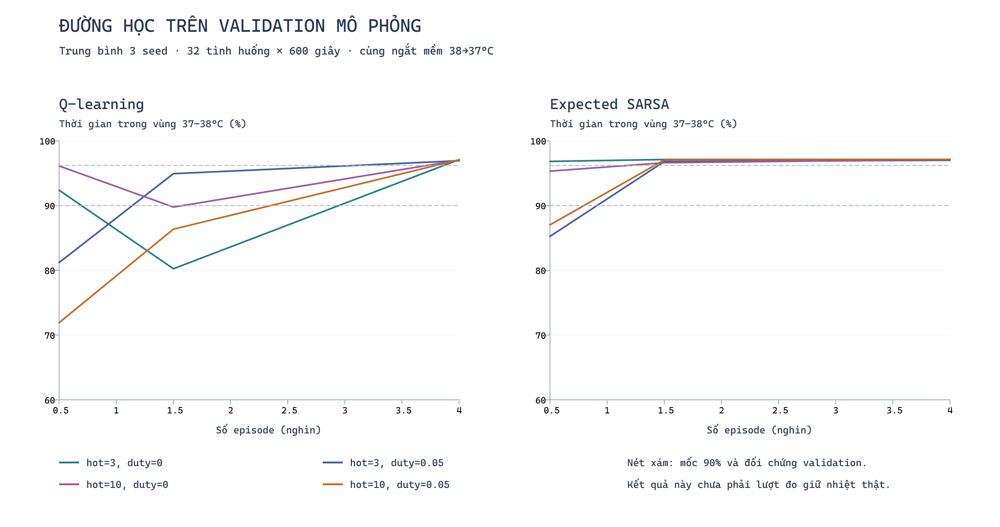

> **Tài liệu cũ (lưu trữ).** Mô tả một giai đoạn phát triển trước; cấu hình hiện hành xem [README.md](../README.md).

# Sau khảo sát: tối ưu offline và kiểm tra giữ nhiệt độc lập

**Cập nhật sau lượt thermostat:** đã có phép đo thực hoàn tất, MAE 0,121°C và 100% thời gian trong 37–38°C. Xem [hướng dẫn thử RL có giám sát](HUONG_DAN_THU_RL.md) cho bước tiếp theo. Những đoạn “chưa chạy Q-table” bên dưới mô tả giai đoạn chuẩn bị đối chứng trước đó; chế độ mặc định vẫn là đối chứng, chỉ chế độ `thu-rl` mới dùng gói pilot mới.

Áp dụng cho bóng 12 V, quạt 12 V, hai MOSFET, DS18B20 và OLED đang lắp. Giữ nguyên vị trí đầu dò, bóng, quạt và trạng thái hộp như lượt khảo sát. Phép thử này dùng hộp rỗng, có người theo dõi.

## 1. Phần đã thực hiện trên laptop

`toi_uu_rl_offline.py` nhận CSV đo thực, sử dụng mô hình đã kiểm tra rồi so Q-learning với Expected SARSA. Bộ này không truy cập GPIO.

- Tập action vẫn phối hợp cả bóng và quạt. Chỉ dùng các tổ hợp đạt cửa sổ khảo sát; dữ liệu ngày 17/11 cho phép 9 tổ hợp.
- State rút từ 729 xuống 162: 9 mức sai lệch × 3 mức xu hướng × 3 mức bộ nhớ sưởi × 2 trạng thái bảo vệ mềm.
- Bỏ action trước khỏi state và đồng thời bỏ phạt đổi action khỏi reward. Không giữ một hạng reward phụ thuộc thông tin đã bỏ khỏi state.
- Dùng chung bảo vệ mềm 38→37°C cho các thuật toán và đối chứng. Khi bảo vệ, chỉ cho action bóng 0%/quạt 100%.
- Thử 500/1.500/4.000 episode, ba seed 11/29/47; chọn cấu hình trên validation. Sau khi chốt, kiểm tra thêm 64 tình huống mô phỏng và hai seed huấn luyện mới 73/101, không chọn lại theo những kết quả này.
- Điều kiện ứng viên: không ra ngoài miền mô hình; trung bình ≥90% thời gian trong 37–38°C; seed thấp nhất ≥80%; số bước bảo vệ và fallback đều ≤1%.
- Sau khi vượt điều kiện, file vẫn là ứng viên mô phỏng, `deploy_allowed=false`. Chương trình kiểm tra trên Pi ở dưới chỉ chạy đối chứng hoặc mức cố định, chưa chạy Q-table.

Kết quả mới nằm tại `../outputs/toi_uu_rl_v2_20261117/KET_QUA.md`. Bộ kiểm tra mới đổi cả cách mã hóa state, lịch học và bảo vệ mô phỏng; không quy toàn bộ khác biệt với phiên bản cũ cho riêng thuật toán RL. Dữ liệu đo cũ đã được xem trước nên mọi kiểm tra mô phỏng phát triển trên đó chưa phải kiểm chứng độc lập trên hộp.

Cấu hình được chọn là **Q-learning, 4.000 episode, hot=10, duty=0,05**, không phạt đổi mức. Trong 64 tình huống mô phỏng kiểm tra sau khi chốt, trung bình năm seed có MAE **0,088°C**, so với **0,149°C** của thermostat; thời gian trong vùng **97,41% so với 96,61%**, tăng khoảng **0,80 điểm phần trăm**. Seed RL thấp nhất đạt **97,30%**. Chưa có lượt điều khiển thật bằng chính sách RL này.

Chênh lệch MAE mô phỏng khoảng 0,061°C; mô hình trên lượt đo cũ có RMSE dự báo 30 giây khoảng 0,073°C. Hai chỉ số khác định nghĩa, không dùng số RMSE đó như khoảng tin cậy cho lợi ích RL. Chúng cho thấy cần kiểm chứng bằng đo thực trước khi suy ra mức cải thiện trên hộp.



Muốn tái lập phép tối ưu trên laptop, từ `D:\BTL_Nhom13` chạy lệnh dưới đây và dùng một thư mục đích chưa tồn tại:

```powershell
python3 Code_HopAp_Demo\toi_uu_rl_offline.py --log Du_lieu_khao_sat\20261117_070909_628598\du_lieu.csv --out outputs\toi_uu_rl_v2_luot_moi
```

Thuật toán: [Sutton & Barto, chương 6, Expected SARSA](https://www.incompleteideas.net/book/bookdraft2018mar21.pdf). Expected SARSA dùng kỳ vọng giá trị action tiếp theo dưới chính sách khám phá; kết quả thực nghiệm của hộp vẫn phải được đo riêng.

## 2. Lượt thực cần chạy tiếp: đối chứng giữ nhiệt 10 phút

Chạy lệnh **trên Terminal laptop Windows**, tại dòng dạng `D:\...>`. Nếu đang thấy `pi@pi:~ $`, gõ `exit` để về laptop trước khi dùng `scp` với đường dẫn `D:\...`.

Chép code đã cập nhật:

```powershell
scp -r "D:\BTL_Nhom13\Code_HopAp_Demo" pi@pi:/home/pi/
```

Xem kế hoạch trước; lệnh này không bật tải:

```powershell
ssh -t pi@pi "python3 /home/pi/Code_HopAp_Demo/kiem_tra_giu_nhiet.py do --bo-dieu-khien doi-chung --dry-run"
```

Dừng chương trình khác đang dùng GPIO18/23. Giữ nguyên dây và bố trí đã khảo sát; cấp USB-C riêng cho Pi và adapter 12 V cho tải. Theo dõi trực tiếp khi chạy lệnh đo:

```powershell
ssh -t pi@pi "python3 /home/pi/Code_HopAp_Demo/kiem_tra_giu_nhiet.py do --bo-dieu-khien doi-chung"
```

Chương trình tự làm các việc sau:

1. Chờ DS18B20 trả số đo hợp lệ; khi chưa có số đo thì không cho sưởi.
2. Nếu hộp còn dưới 37°C, làm ấm bằng bóng 75%/quạt 100%, tối đa 600 giây. Nếu đầu dò đang ≥38°C, chỉ làm nguội và chờ về 37°C. Quá thời gian mà chưa đủ điều kiện thì dừng.
3. Bắt đầu **600 giây kiểm tra giữ nhiệt** khi đủ điều kiện. Đối chứng được đọc từ `doi_chung_kiem_tra.json`, đã chốt theo validation mô phỏng. Cập nhật mức điều khiển mỗi 5 giây; đọc/ghi nhiệt khoảng mỗi giây.
4. Khi đạt 38°C, bóng 0%/quạt 100%; khi về 37°C mới trở lại điều khiển. **Thời gian bảo vệ vẫn tính trong 600 giây**, không tạm dừng đồng hồ để làm đẹp kết quả.
5. Nhiệt đạt 40°C hoặc không có số đo hợp lệ quá 3 giây thì dừng thử. Phần mềm giữ các kiểm tra này độc lập với policy.
6. Kết thúc: tắt bóng, giữ quạt 100% thêm 10 giây rồi tắt cả hai. OLED và CSV hoạt động qua bộ đo hiện có.

Tổng thời gian mặc định: làm ấm tối đa 10 phút + đo 10 phút + 10 giây quạt cuối, thêm vài giây khởi tạo. Nếu hộp đã đủ ấm thì phần làm ấm ngắn hơn. Ctrl+C để dừng; nếu tải không tắt theo chương trình thì ngắt adapter 12 V.

## 3. Đọc và lấy kết quả

Terminal in `KẾT QUẢ: ...` khi bắt đầu và `BÁO CÁO: ...` khi phân tích xong. Mỗi lượt tạo thư mục mới dưới `Code_HopAp_Demo/ket_qua_giu_nhiet/`:

| File | Nội dung |
|---|---|
| `du_lieu.csv` | Số đo và lệnh điều khiển |
| `cau_hinh.json` | Cấu hình đối chứng, thời gian làm ấm, trạng thái hoàn tất, số lần bảo vệ |
| `phan_tich/KET_QUA.md` | Báo cáo giữ nhiệt thực |
| `phan_tich/ket_qua.json` | MAE, tỷ lệ trong vùng, thời gian quá/ngưỡng dưới, độ phủ mẫu |

Chỉ số giữ nhiệt loại giai đoạn làm ấm và quạt cuối; vẫn giữ thời gian bảo vệ nằm trong giai đoạn đo. Không có END, có ERROR hoặc thiếu thời gian/số đo thì báo chưa hoàn tất. `COMPLETED_HARDWARE_HOLD_TEST` chỉ có nghĩa phiên đã chạy đủ và có dữ liệu, không tự có nghĩa điều khiển tốt hoặc đủ yêu cầu ấp trứng.

Lấy dữ liệu về bằng Terminal laptop:

```powershell
scp -r pi@pi:/home/pi/Code_HopAp_Demo/ket_qua_giu_nhiet "D:\BTL_Nhom13\Du_lieu_giu_nhiet"
```

Sau đó có thể phân tích cùng mô hình cũ để kiểm tra sai lệch trên một lượt mới; không tự gộp lượt kiểm tra vào train trước khi đánh giá.

## 4. Tùy chọn sau lượt đối chứng: kiểm chứng mức bóng 50%

Chạy lượt riêng, cùng bố trí và đưa hộp về điều kiện đầu tương đương. Mức cố định vẫn bị bảo vệ mềm và dừng cứng như trên:

```powershell
ssh -t pi@pi "python3 /home/pi/Code_HopAp_Demo/kiem_tra_giu_nhiet.py do --bo-dieu-khien co-dinh --bong 50 --quat 75"
```

Hoặc đổi `--quat 100` trong một lượt riêng. Không chạy hai chương trình cùng lúc. Đây là kiểm chứng điểm làm việc; không gọi là điều khiển RL.

Khi đổi tải, thêm nước, đổi vị trí đầu dò/quạt hoặc thay trạng thái nắp, cần ghi lại vì điều kiện nhiệt đã thay đổi. Một đầu dò và các lệnh PWM chưa đo được độ đồng đều, độ ẩm, công suất điện hay hiệu quả nở trứng.
