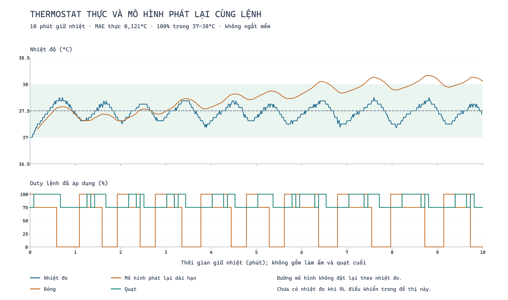

# Đánh giá lượt giữ nhiệt độc lập ngày 17/11/2026

Thermostat đã hoàn tất 10 phút trên hộp thật. Các phép kiểm tra mô hình/policy bên dưới hoàn toàn offline; giữ nguyên Q-table.

| Chỉ số đo thực | Kết quả |
|---|---:|
| MAE so với 37,5°C | 0.121°C |
| Trong vùng 37–38°C | 100.0% |
| Nhiệt nhỏ nhất / lớn nhất | 37.000 / 37.750°C |
| Thời gian được đánh giá | 600.0s |
| Bảo vệ mềm | 0 lần |

## Mô hình đóng băng có còn phù hợp?

- RMSE dự báo 5 giây: 0.050°C.
- RMSE các đường dự báo 30 giây: 0.111°C; giữ nguyên nhiệt hiện tại: 0.223°C.
- Khi phát lại gần 10 phút bằng lệnh đã ghi, không đặt lại nhiệt theo số đo: RMSE 0.372°C, lệch trung bình +0.268°C.
- Mô hình qua điều kiện kiểm tra ngắn hạn không chứng minh mọi chuỗi action hoặc mô phỏng 10 phút đều chính xác.
- Nhiệt ban đầu 26,437°C thấp hơn miền nhận dạng cũ. Không dùng đoạn khởi động lạnh ngoài miền để tuyên bố mô hình đã được kiểm tra; các chỉ số mô hình ở đây chỉ dùng giai đoạn giữ nhiệt trong miền.

## Kiểm tra policy và độ nhạy

- Cùng đầu dò/tần số: True/True; xác nhận hộp rỗng, bố trí không đổi: True.
- Phát lại trạng thái từ log thật: cả ba policy đều không gặp state chưa học. Đây là khuyến nghị ở chế độ shadow, chưa tạo ra nhiệt đo mới.
- Stress mô phỏng dùng phần dư của lượt mới: thermostat MAE 0.131°C; RL trung bình ba seed 0.076°C.
- Phần dư được lấy lại theo block 30 giây để giữ tương quan ngắn hạn. Không coi phép này là chứng minh hiệu năng RL trên hộp thật.

## Bước thử tiếp theo

Cho phép chuẩn bị pilot hộp rỗng có giám sát: **True**. Triển khai tự động: **False**.
Seed pilot cố định là 11, seed đầu tiên của ứng viên ban đầu; không chọn seed đẹp nhất theo lượt mới hoặc stress test.
Giữ nguyên Q-table, chỉ suy luận; bảo vệ mềm 38→37°C, dừng cứng 40°C/mất số đo 3 giây. State ngoài miền/chưa học thì dừng pilot.
Thermostat đã đạt 100% trong vùng ±0,5°C ở lượt này. RL cần chứng minh lợi ích ở sai số, độ dao động hoặc mức hoạt động; không thể tăng tỷ lệ này lên trên 100%. Chưa đo Wh nên không tuyên bố tiết kiệm điện.

Lượt RL sắp chạy mới cung cấp phép so thực nghiệm. Hai lượt liên tiếp vẫn chịu ảnh hưởng nhiệt phòng và điều kiện đầu; cần lặp/đổi thứ tự nếu muốn kết luận chắc.

Log mới SHA-256: `e5a3d6dcc0a1683bc8fe1704a654db3af2f7aeb6e6f17a6b1dae36e74a8dee93`. Không gộp lượt kiểm tra vào train hoặc chọn lại reward trong bước này.
