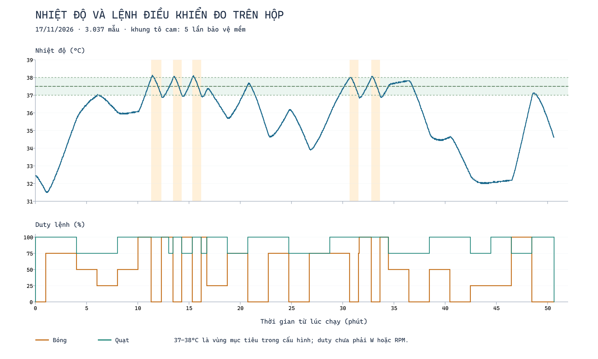
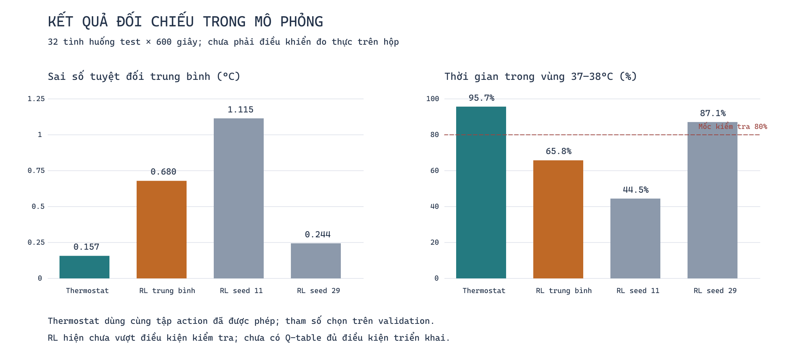

# Phân tích khảo sát hộp ấp ngày 17/11/2026

Lượt đo: `20261117_070909_628598`. Phân tích hoàn toàn offline từ dữ liệu đã chép về laptop; giữ nguyên log và kết quả gốc.

## Kết luận chính

Hệ bóng–quạt tạo được đáp ứng nhiệt rõ ràng tại đầu dò: nhiệt độ đo được **31,500–38,125°C**. Lịch khảo sát đã hoàn tất, dữ liệu đọc liên tục, đủ khớp một mô hình dự báo nhiệt ngắn hạn theo các điều kiện đã đo. Tuy nhiên, **Q-learning hiện chưa đạt yêu cầu và đang thua đối chứng trong mô phỏng**. Chưa có cơ sở gọi bộ reward hoặc Q-table hiện tại là tối ưu, và chương trình đã không xuất Q-table triển khai.

Bước có ích ngay lúc này là kiểm tra giữ nhiệt quanh 37,5°C và cải thiện độ ổn định của huấn luyện offline. Chưa cần đo lại toàn bộ khảo sát chỉ vì chưa có Q-table.

## 1. Dữ liệu và chất lượng ghi nhận

| Nội dung | Kết quả |
|---|---:|
| Thời gian theo giờ Việt Nam | 14:09:10–14:59:47, 17/11/2026 |
| Tổng thời gian từ khi bắt đầu chương trình đến END | 3037.85 giây, khoảng 50 phút 38 giây |
| Số mẫu nhiệt MEASUREMENT | 3,037 |
| Khoảng cách lớn nhất giữa hai mẫu | 1.032 giây |
| Tuổi số đo lớn nhất khi được ghi | 0.056 giây |
| Lỗi đọc cảm biến / ERROR trong log | Không ghi nhận |
| Tần số PWM quạt được ghi | 100 Hz |
| Lịch 20 lượt thử: 10 tổ hợp × 2 lần | Đã hoàn tất theo cấu hình |
| Số lượt thử đủ cửa sổ liên tục ~120 giây | 16/20 |
| Tổ hợp có ít nhất một cửa sổ đủ liên tục | 9/10 |
| Số lần bảo vệ mềm | 5 |

Cửa sổ có 120 mẫu cách nhau khoảng một giây thường có khoảng cách mẫu đầu–cuối khoảng 119 giây; đây là lý do báo cáo ghi 119/120 và vẫn đánh dấu đủ. Khi bị bảo vệ mềm, chương trình dừng tính thời gian kích thích rồi tiếp tục phần còn lại. Vì vậy “lịch đã hoàn tất” không có nghĩa tất cả lượt đều có 120 giây không bị ngắt.

SHA-256 của CSV chép về trùng bản gốc đã được Pi phân tích: `7ed00d0151a9d84d4c0d201e26b65f8a63ca9cc0ed0362250364a6d3fac9de14`. Đã tái tính bảng đáp ứng, mô hình và hai chính sách được chọn với đúng seed/tham số; các chỉ số test trùng kết quả gốc trong sai số số học 1e-12.

## 2. Từng mức bóng–quạt đang làm được gì?

Độ dốc dưới đây là hồi quy từ số đo sau khi bỏ 5 giây đầu mỗi đoạn. Bảng chỉ gộp các **đoạn đủ liên tục**, không cộng hai đoạn bị ngắt thành một đoạn dài. Đơn vị °C/phút. Đây là đáp ứng trong khoảng nhiệt ban đầu khác nhau, chưa phải phép so sánh nhân quả giữa hai mức quạt.

| Bóng (%) | Quạt (%) | Lượt đủ liên tục / 2 lượt dự kiến | Khoảng độ dốc từ lượt đủ (°C/phút) |
|---:|---:|---:|---:|
| 0 | 75 | 2/2 | -1.553 đến -1.186 |
| 0 | 100 | 2/2 | -1.571 đến -1.172 |
| 25 | 75 | 2/2 | -0.534 đến -0.140 |
| 25 | 100 | 2/2 | -0.901 đến +0.070 |
| 50 | 75 | 2/2 | +0.114 đến +0.617 |
| 50 | 100 | 2/2 | -0.031 đến +0.062 |
| 75 | 75 | 2/2 | +1.042 đến +1.091 |
| 75 | 100 | 1/2 | +0.824 |
| 100 | 75 | 1/2 | +2.485 |
| 100 | 100 | 0/2 | —; chỉ có đoạn bị ngắt |

Những quan sát quan trọng:

- **Bóng 0%:** nhiệt giảm khoảng 1,17–1,57°C/phút trong các đoạn thử đủ dài. Đây là tác dụng nguội tổng của hộp khi ngừng sưởi và quạt còn chạy; chưa tách được phần mất nhiệt tự nhiên và phần do quạt.
- **Bóng 25%:** phần lớn đoạn đang nguội, đặc biệt ở khoảng nhiệt cao. Ví dụ 25%/quạt 100% giảm từ 37,312 xuống 35,750°C. Ở khoảng 32°C, cùng tổ hợp lại gần ngang hoặc nhích lên. Không thể gắn một tốc độ cố định cho từng action.
- **Bóng 50%/quạt 75%:** ở lượt bắt đầu 37,500°C, kết thúc 37,812°C sau khoảng hai phút, dốc toàn đoạn +0,114°C/phút, 30 giây cuối +0,073°C/phút. Đây là điểm khởi đầu đáng thử cho giữ nhiệt quanh mục tiêu, chưa chứng minh giữ ổn định lâu dài.
- **Bóng 50%/quạt 100%:** một đoạn khoảng 36,062°C có thay đổi ròng gần 0; đoạn khác bắt đầu 34,875°C và kết thúc 34,625°C, nhưng 30 giây cuối đã tăng +0,219°C/phút. Lịch sử sưởi trước đó còn tác động; không thể kết luận 50% này luôn giữ đúng 37,5°C.
- **Bóng 75–100%:** nhiệt tăng rõ, phù hợp để khảo sát làm ấm trong phiên có giám sát. Gần mục tiêu, giữ các mức này liên tục dễ kích hoạt bảo vệ. Lượt 100%/quạt 75% tăng +2,485°C/phút khi bắt đầu từ 32,187°C; không dùng tốc độ đó để ngoại suy ở 37,5°C.
- Quạt 75% và 100% đều cần tiếp tục có mặt trong action phối hợp. Log có dấu hiệu mức quạt làm thay đổi đáp ứng, nhưng nhiệt ban đầu và lịch sử bóng khác nhau nên chưa xác định riêng được hiệu quả của việc tăng quạt. Một đầu dò cũng chưa đo được độ đồng đều nhiệt trong hộp.

Trong giai đoạn làm ấm 180 giây, nhiệt từ khoảng 31,56 lên 35,63°C, chưa chạm ngưỡng kết thúc làm ấm 37°C. Toàn lượt sau đó vẫn có số đo qua vùng mục tiêu; cờ `warm_target_reached=false` không có nghĩa toàn khảo sát thất bại.

## 3. Ngắt sưởi và quán tính nhiệt

| Lần bảo vệ mềm | Bắt đầu tại phút | Thời gian giữ bóng 0% / quạt 100% (s) | Đỉnh nhiệt trong đoạn (°C) | Nhiệt lúc tiếp tục (°C) |
|---:|---:|---:|---:|---:|
| 1 | 11.30 | 60.0 | 38.125 | 37.000 |
| 2 | 13.44 | 51.0 | 38.062 | 37.000 |
| 3 | 15.32 | 52.0 | 38.125 | 37.000 |
| 4 | 30.67 | 52.0 | 38.000 | 37.000 |
| 5 | 32.79 | 51.0 | 38.062 | 37.000 |

Mỗi lần, phần mềm chuyển sang bóng 0%/quạt 100% khi đầu dò đạt 38°C và chỉ tiếp tục khảo sát khi về 37°C. Có lần đầu dò vẫn tăng lên **38,125°C khoảng 7 giây sau lệnh tắt bóng**. Đây là bằng chứng thực nghiệm cần xét xu hướng nhiệt và lịch sử sưởi, thay vì chỉ chờ chạm ngưỡng rồi mới tắt.

Không có số đo chạm ngưỡng ngắt phần mềm cứng 40°C. Lượt này cũng không kiểm chứng được KSD301 đã tác động hay chưa. Các phần trăm trong log là lệnh GPIO/PWM; chưa có phép đo W, RPM hoặc phản hồi dòng điện để xác nhận độc lập từng cơ cấu chấp hành.

Tỷ lệ thời gian khảo sát nằm trong 37–38°C chỉ khoảng **28.5%**, tính có trọng số theo thời gian mẫu. Đây là lịch cố tình thử các mức tăng/giảm nhiệt, **không phải** chỉ số chất lượng một bộ điều khiển giữ nhiệt. Không dùng tỷ lệ này để so trực tiếp với RL hoặc thermostat ở phần mô phỏng.

## 4. Mô hình nhiệt: dùng được đến đâu?

Mô hình được khớp trên khoảng 60% dữ liệu đầu, chọn cấu hình bằng 20% tiếp theo và kiểm tra bằng 20% cuối, có khoảng cách 10 giây ở ranh giới. Ba phần vẫn thuộc cùng một lượt đo, chưa phải ba thí nghiệm độc lập.

| Chỉ số dự báo 30 giây | Validation | Test cuối lượt |
|---|---:|---:|
| RMSE mô hình (°C) | 0,0745 | 0,0725 |
| RMSE nếu giữ nguyên nhiệt hiện tại (°C) | 0,3072 | 0,4292 |

Mô hình có bộ nhớ sưởi dạng lọc với tham số 25 giây, tốt nhất trong ba giá trị đã thử 0/10/25 giây. **25 giây là tham số của mô hình được chọn**, chưa phải phép đo hằng số thời gian vật lý chính xác của hộp. Dự báo 30 giây khá sát số đo trong lượt này cũng chưa bảo đảm mô phỏng kín 10 phút luôn đúng, đặc biệt khi bố trí, nhiệt phòng hoặc tải trong hộp thay đổi.

Tổ hợp bóng 100%/quạt 100% chỉ có các đoạn liên tục tối đa khoảng 77 giây do bảo vệ. Công cụ loại tổ hợp này khỏi tập action ứng viên theo quy tắc đã đặt; hiện chỉ có **9 action**. Không tăng ngưỡng bảo vệ để cố lấy đủ đoạn. Các phần dữ liệu quá độ vẫn hữu ích cho nhận dạng.

Với cách mã hóa hiện tại, 9 action tạo **729 state và bảng 729×9**, gồm 9 mức sai lệch nhiệt × 3 xu hướng × 3 mức bộ nhớ sưởi × 9 action trước đó. Con số 810×10 chỉ áp dụng khi cả 10 action được phép.

## 5. Kết quả RL thực sự

Chương trình đã thử 18 bộ hệ số, mỗi bộ huấn luyện 250 episode cho từng seed 11 và 29. Mô phỏng test gồm 32 tình huống, mỗi tình huống 600 giây. Bảng sau hoàn toàn là kết quả mô phỏng trên mô hình vừa khớp, chưa có lượt RL/PID/thermostat điều khiển thật để so sánh.

| Bộ điều khiển | MAE (°C) | Thời gian trong vùng 37–38°C | Tỷ lệ tình huống ra ngoài miền mô hình |
|---|---:|---:|---:|
| Thermostat đối chứng | 0,157 | 95,70% | 0% |
| Q-learning, trung bình hai seed | 0,680 | 65,79% | 1,56% |
| Q-learning seed 11 | 1,115 | 44,48% | 3,125% |
| Q-learning seed 29 | 0,244 | 87,11% | 0% |

Đối chứng được chọn là thermostat có hysteresis ±0,1°C và quạt theo quy tắc xu hướng, dùng cùng tập action được phép; không phải PID. Tham số đối chứng cũng được chọn trên validation. Chỉ số MAE của các tình huống ra ngoài miền mô hình có phần phạt cho các bước chưa thể mô phỏng tiếp; không nên diễn giải toàn bộ 0,680°C như sai số đo trên thiết bị thật.

Hệ số được xếp cao nhất trong lượt thử hiện tại là `hot=10`, `duty=0.2`, `switch=0.03`, với trọng số sai số nhiệt bằng 1. Tuy nhiên, validation chỉ đạt 70,03% trong vùng, thấp hơn điều kiện 80%; test cũng không đạt. Tất cả 18 bộ thử đều chưa đạt 80% thời gian trong vùng trên validation khi lấy trung bình hai seed. Vì vậy **đây không phải bộ hệ số đã tối ưu hoặc đủ điều kiện triển khai**.

## 6. Vì sao RL hiện còn kém?

Các điểm sau giải thích hướng điều tra, chưa phải bằng chứng chỉ có một nguyên nhân duy nhất:

1. **Độ ổn định huấn luyện còn thấp.** Cùng mô hình và reward nhưng hai seed cho 44,48% và 87,11% thời gian trong vùng trên test. Không được chỉ lấy seed 29 để công bố kết quả tốt.
2. **Bảng trạng thái lớn so với số lần cập nhật hữu ích.** Khi tái chạy đúng cấu hình, seed 11/29 có khoảng 29.240/29.431 cập nhật. Chỉ 2.675/2.685 cặp state–action được thăm trong tổng 6.561 ô; trung vị số lần thăm các ô đã thấy chỉ 5/4. Một phần state có thể không đạt tới nên không yêu cầu phủ hết bảng, nhưng số liệu này cùng chênh lệch seed cho thấy cần kiểm tra hội tụ trước khi kết luận về reward.
3. **Cách xếp hạng ưu tiên tuyệt đối mức vượt nhiệt trước tỷ lệ trong vùng.** Bộ đang chọn có diện tích vượt vùng trên validation 0,003773°C·phút, so với 0,004149°C·phút của bộ `10/0.2/0`; chênh khoảng 0,000376°C·phút đủ làm bộ đạt 70,03% được xếp trên bộ đạt 75,29%. Đây là hệ quả thứ tự tiêu chí hiện tại. Đổi xếp hạng riêng lẻ cũng chưa giải quyết việc cả 18 bộ chưa đạt mốc 80%.
4. **Mô hình mới được kiểm tra ngắn hạn trong một phiên.** RL có thể chọn chuỗi action ít giống lịch khảo sát; sai số mô hình ở chuỗi đó có thể khác. Chưa thể dùng mô phỏng để xác nhận cải tiến trên hộp thật.

## 7. Nên làm tiếp theo

1. **Giữ nguyên bộ dữ liệu này làm mốc.** Không cần mua thêm cảm biến hoặc thay linh kiện chỉ vì kết quả RL chưa đạt. Nếu có di chuyển đầu dò, bóng, quạt, thay nắp hoặc thêm nước/tải thì ghi rõ, vì điều đó tạo điều kiện khác.
2. **Kiểm tra giữ nhiệt quanh mục tiêu trong một lượt độc lập có giám sát.** Gợi ý quan sát bóng 50% với quạt 75% hoặc 100%, mỗi đoạn 5–10 phút nếu chưa chạm ngưỡng bảo vệ. Khi gần 38°C hoặc có lỗi đọc, vẫn phải ngắt sưởi theo chương trình. Mục tiêu là kiểm chứng vùng duy trì và quán tính, không cố đủ thời gian bằng cách bỏ bảo vệ. Chưa tự chạy khảo sát mới trong lần phân tích này.
3. **Cải thiện RL offline trên validation trước khi đưa lên Pi.** Kiểm tra đường học qua nhiều mức episode và nhiều seed; xem độ ổn định thay vì chỉ tăng một lần rồi chọn kết quả đẹp. Có thể thử mô hình trạng thái gọn hơn gồm sai lệch, xu hướng và bộ nhớ sưởi. Nếu bỏ action trước khỏi state, cần tạm bỏ hạng phạt đổi action hoặc đưa đủ thông tin đó về state. Đây là giả thuyết cần kiểm tra, không mặc định sẽ tốt hơn.
4. **Chốt tiêu chí đạt trước khi thử reward tiếp.** Đặt rõ điều kiện vượt nhiệt chấp nhận được, không ra ngoài miền mô hình, tỷ lệ giữ vùng và sai số; lọc theo điều kiện đạt rồi mới cân nhắc duty/chuyển mức. Các hệ số không thể được xác định duy nhất chỉ từ tốc độ tăng nhiệt.
5. **Dùng dữ liệu kiểm tra mới sau khi sửa thiết kế.** Tập test hiện đã được đọc trong báo cáo này. Không tiếp tục chỉnh theo test cũ rồi gọi đó là kiểm tra độc lập. Cuối cùng cần đo RL và đối chứng trên cùng phần cứng, cùng điều kiện đầu/nhiễu, với log riêng.

Độ ẩm chưa xuất hiện trong log. DHT11/SHT31 chỉ thêm khả năng quan sát nếu được lắp và tích hợp; kết quả hiện tại không đánh giá được điều khiển độ ẩm, độ đều nhiệt, tiết kiệm Wh hoặc tỷ lệ nở trứng.

## Nguồn và cách kiểm tra

- Đo thực: `../../Du_lieu_khao_sat/20261117_070909_628598/du_lieu.csv` và `cau_hinh.json`.
- Báo cáo tự động: thư mục `phan_tich` của cùng lượt, gồm `phan_tich.json`, `dap_ung_tung_buoc.csv`, `thu_he_so_reward.csv`.
- Kiểm tra độc lập kèm báo cáo: `kiem_tra_doc_lap.json`; đồ thị đo thực và mô phỏng được lưu riêng, mỗi đồ thị có PNG và SVG.
- Không dùng các kết quả mô phỏng giả định cũ hoặc dữ liệu kiểm thử SYNTHETIC làm kết quả thực nghiệm của lượt này.
