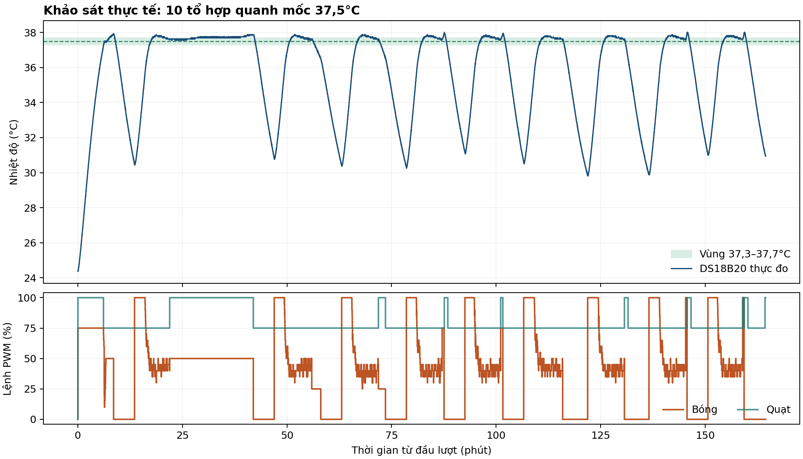
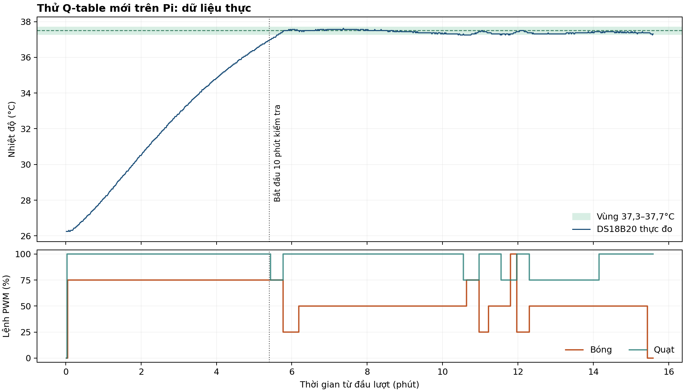
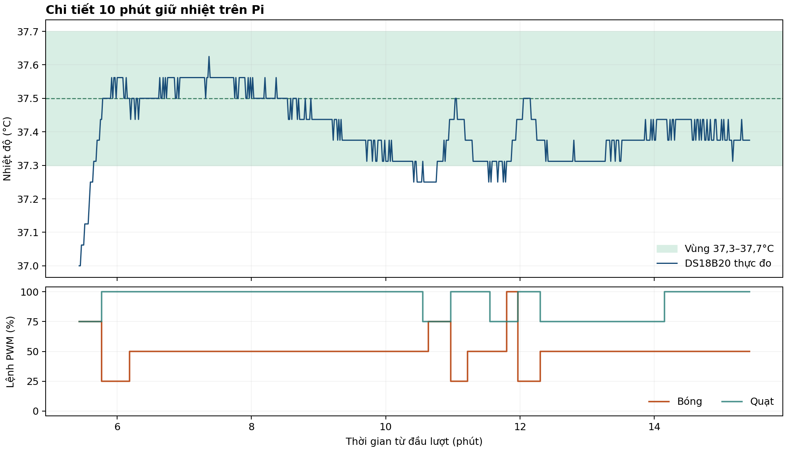

# Phân tích và huấn luyện từ lượt đo ngày 20/11/2026

## Dữ liệu thực tế

Nguồn: `Du_lieu_dap_ung/du_lieu.csv`. SHA256: `31b35425b9d9a143d90277a2d8cbe8845eae21fdbf412479ab50738bfe6e5847`.
Có 9862 mẫu nhiệt, đúng đầu dò 28-000000ca6c1f; không có lỗi cảm biến hoặc khoảng mất mẫu trên 3 giây.
Lượt này chỉ đo mốc 37,5°C (mốc giữa trong kế hoạch ba giai đoạn). Chưa xác nhận các chính sách 37,8°C và 37,2°C bằng dữ liệu tương ứng.
Đã chạy hết 10 tổ hợp nhưng chỉ bóng 50% / quạt 100% đủ 1.200 giây. Các tổ hợp khác dừng kích thích khi chạm giới hạn 36,5 hoặc 37,9°C; thời gian ngắn không phải lỗi thu thập.
Không suy cân bằng nhiệt dài hạn từ các đoạn kích thích ngắn. Các điều kiện đầu chưa giống hoàn toàn, nên chưa khẳng định độc lập tác dụng của quạt chỉ từ so cặp.

| Bóng | Quạt | Kích thích thực (s) | Đủ 20 phút | Nhiệt trung bình (°C) | Trong vùng (%) |
|---:|---:|---:|:---:|---:|---:|
| 50% | 75% | 109.0 | Không | 37.694 | 51.8 |
| 50% | 100% | 1200.0 | Có | 37.695 | 65.2 |
| 25% | 75% | 129.0 | Không | 37.100 | 35.2 |
| 25% | 100% | 101.0 | Không | 37.122 | 37.0 |
| 75% | 75% | 27.0 | Không | 37.728 | 50.0 |
| 75% | 100% | 31.0 | Không | 37.729 | 40.0 |
| 0% | 75% | 58.0 | Không | 37.146 | 40.4 |
| 0% | 100% | 52.0 | Không | 37.153 | 43.1 |
| 100% | 75% | 20.0 | Không | 37.710 | 57.9 |
| 100% | 100% | 20.0 | Không | 37.724 | 52.5 |

Các phần chuẩn bị có mức bóng 30/35/40% là dữ liệu bộ điều khiển chuẩn bị; chúng không được ghi thành action RL mới.



## Nhận dạng mô hình

Mô hình 5 giây dự đoán thay đổi nhiệt từ nhiệt hiện tại, thay đổi nhiệt bước trước, bộ nhớ sưởi, mức quạt và tương tác sưởi–quạt. Bộ nhớ sưởi dùng PWM đã áp dụng, không phải công suất đo bằng watt.
Chọn thời hằng bằng cách giữ nguyên từng chu kỳ chuẩn bị–kích thích–sau tắt khi chia tập. Chu kỳ 1–8 dùng chọn mô hình; chu kỳ 9–10 giữ lại đến khi chốt thời hằng. Sau đánh giá mới khớp lại toàn bộ để huấn luyện.
Thời hằng chọn: 25s. RMSE trung bình giữa các chu kỳ: 0.058°C cho dự đoán tự chạy 30s; 0.094°C cho 60s.
Đây là kiểm tra giữa các đoạn trong cùng lượt đo; vẫn cần thử vật lý độc lập. Môi trường ngoài chưa đo, không có dữ liệu trứng thật hoặc mô hình độ ẩm.

## Huấn luyện Q-learning

Mục tiêu 37,3–37,7°C, tâm 37,5°C. 2.430 trạng thái gồm sai số, xu hướng nhiệt, bộ nhớ sưởi, action trước và cờ bảo vệ. Tập 9 action cũ giữ nguyên; tổ hợp 100%/100% chưa đưa vào pilot mới.
Reward thưởng ở trong vùng, phạt xa vùng và chậm quay về; phạt đổi tổ hợp và biên độ đổi. Trong vùng đổi mức bị phạt mạnh hơn ngoài vùng. Bảo vệ mềm ghi nhận trong thời gian kiểm tra.
Đã thử 24 ứng viên: 4 hệ số phạt đổi × 3 seed × 2 cách quyết định (5s hoặc SMDP danh định 30s trong vùng/10s ngoài vùng). Mỗi ứng viên 64,000 episode, mỗi episode tối đa 10 phút mô phỏng. Chọn trên 128 tình huống validation, sau đó đánh giá 192 tình huống test với cùng nhiễu và điều kiện đầu cho các bộ điều khiển.
Chọn `Q_5s`, hệ số đổi=1, hệ số quay về=4, seed=47. Xét action mỗi 5 giây; không ép thay đổi mỗi 5 giây. Chưa khóa cứng action khi nhiệt ở trong vùng.

| Chỉ số mô phỏng / 10 phút | Q mới | Q cũ trên cùng mô hình mới |
|---|---:|---:|
| Thời gian trong vùng | 98.05% | 97.27% |
| MAE so với 37,5°C | 0.066°C | 0.115°C |
| Lần đổi mức bóng | 8.26 | 67.96 |
| Lần đổi mức quạt | 4.28 | 54.56 |
| Lần đổi tổ hợp | 11.06 | 68.61 |
| Đoạn ở trong vùng liên tục dài nhất, trung bình | 502.5s | 407.9s |

Các số trên là kết quả mô phỏng có điều kiện theo mô hình đã khớp. Không dùng chúng như số đo máy thật hoặc chứng minh tăng tỷ lệ nở.
Bộ thermostat tham chiếu ở đây chỉ là relay vùng chết dùng cùng action đã hỗ trợ; chưa đại diện cho mọi PID/thermostat đã tinh chỉnh.

## Chạy thử trên Pi

Trạng thái: **COMPLETED_PHYSICAL_PILOT**. Nguồn CSV: `Du_lieu_giu_nhiet\20261120_pilot_01/du_lieu.csv`.
SHA256: `abdd0258399a89be595338a01ba032b0b29ec017457f1eb6992cacf71124c8f0`.
Làm ấm 324.0s, dữ liệu giữ nhiệt 600.0s.
Trong vùng: **93.83%**; MAE **0.109°C**; min–max **37.000–37.625°C**.
Đổi bóng **8** lần; đổi quạt **7** lần; đổi tổ hợp **11** lần. Không tính lệnh đầu vào giai đoạn giữ nhiệt.
Đoạn trong vùng liên tục dài nhất: **286.0s**; bảo vệ mềm cả phiên: **0** lần.
Giữ nguyên một tổ hợp: trung bình **50.0s**, trung vị **20.1s**, dài nhất **261.7s**.
74.8% thời gian giữ nhiệt thuộc các đoạn giữ nguyên action ít nhất 30s.

| Bóng/quạt (%) | Thời gian áp dụng thực (s) |
|---|---:|
| 50/100 | 358.4 |
| 50/75 | 130.9 |
| 25/100 | 60.4 |
| 75/75 | 40.3 |
| 100/75 | 10.1 |





Kiểm tra mô hình trên lượt Pi độc lập này: RMSE dự đoán tự chạy 30s = 0.071°C; 60s = 0.127°C; cả đoạn 595s không hiệu chỉnh bằng số đo = 0.618°C.
Đây là chẩn đoán sau thử; lượt Pi chưa được thêm vào huấn luyện. Chất lượng giữ nhiệt thực tế và sai số mô hình được báo cáo riêng.
Mô hình tích lũy sai số đáng kể sau nhiều phút: chưa dùng để dự báo dài hạn hoặc khẳng định chính sách tối ưu. Cần bổ sung nhiều lượt giữ nhiệt ở các điều kiện nền và đánh giá lại trên lượt độc lập trước khi chốt phiên bản cuối.
Độ ẩm: có 0 mẫu đọc được. DHT11 không đưa vào state/action/reward; lỗi độ ẩm không thay số đo nhiệt.
Chỉ có một lượt thử hộp rỗng; so với dữ liệu Q cũ khác ngày chưa tách được tác động nhiệt độ phòng. Muốn kết luận hiệu quả thực tế cần chạy đối chứng cùng điều kiện và lặp lại.
Q-table giữ nguyên trong lượt thử, không học online. Chương trình ngắt mềm 38→37°C; dừng cứng 38,5°C, sai đầu dò hoặc mất số đo 3s.

### Đối chiếu tham khảo với lượt Q cũ ngày 17/11

Nguồn cũ: `Du_lieu_giu_nhiet\ket_qua_giu_nhiet\20261117_092305_477345\du_lieu.csv`, SHA256 `2642c2f3d71416bb1d424b277e202c5a8a2e82dcdc1a52ee2194b32d213eb1b2`. Dùng cùng vùng và cách đếm đổi mức, loại làm ấm/quạt cuối.

| Số đo thực / 10 phút | Lượt Q mới | Lượt Q cũ |
|---|---:|---:|
| Trong 37,3–37,7°C | 93.83% | 97.68% |
| MAE | 0.109°C | 0.057°C |
| Đổi mức bóng | 8 | 88 |
| Đổi mức quạt | 7 | 52 |
| Đổi tổ hợp | 11 | 88 |

Bản mới ít đổi mức hơn nhưng giữ vùng kém hơn lượt cũ này. Hai lượt khác ngày, chưa kiểm soát nhiệt môi trường nên đây là đối chiếu tham khảo, chưa chứng minh quan hệ nhân quả hoặc RL tốt hơn mọi bộ điều khiển thông thường.

## Chạy lại đúng bản đã thử

Trong Terminal Pi:

```bash
cd /home/pi/Code_HopAp_Demo
.venv/bin/python thu_rl_du_lieu_moi.py --dry-run
.venv/bin/python thu_rl_du_lieu_moi.py --dht11
```

Bắt đầu khi hộp rỗng, nhiệt không quá 30°C, giữ nguyên bố trí và có người theo dõi. Bỏ `--dht11` nếu chưa nối cảm biến ẩm. OLED mặc định bật. Ctrl+C dừng và tắt sưởi.
Lệnh cũ `kiem_tra_giu_nhiet.py ... --bo-dieu-khien thu-rl` vẫn dùng gói Q cũ; muốn thử gói mới phải chạy chương trình phía trên.
