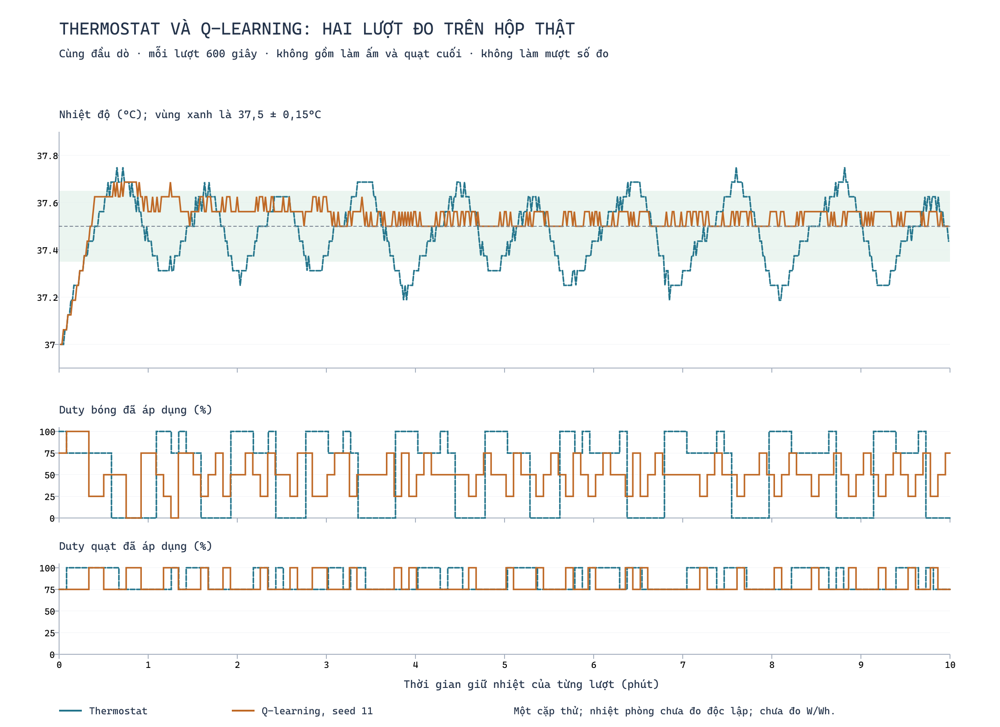

# So sánh thermostat và Q-learning trên hộp thật — 17/11/2026

**Trong cặp lượt thử này, Q-learning giảm MAE 53.2% và giảm độ lệch chuẩn nhiệt 43.3% so với đối chứng thermostat đã chọn.**
Cả hai lượt đều hoàn tất 600 giây và giữ nhiệt trong 37–38°C suốt giai đoạn đánh giá.



## Kết quả đo thực

| Chỉ số | Thermostat | Q-learning |
|---|---:|---:|
| MAE so với 37,5°C | 0.1214°C | 0.0568°C |
| RMSE | 0.1490°C | 0.0899°C |
| Độ lệch chuẩn nhiệt | 0.1453°C | 0.0825°C |
| Nhiệt trung bình | 37.4674°C | 37.5358°C |
| Nhiệt nhỏ nhất–lớn nhất | 37.000–37.750°C | 37.000–37.687°C |
| Trong 37,5 ± 0,15°C | 66.67% | 94.85% |
| Trong 37,5 ± 0,25°C | 97.50% | 98.01% |
| Trong 37,5 ± 0,5°C | 100.00% | 100.00% |
| Bảo vệ mềm | 0 | 0 |
| Duty bóng trung bình | 53.88% | 50.56% |
| Duty quạt trung bình | 85.69% | 81.26% |
| Số lần đổi tổ hợp mức PWM | 53 | 88 |
| Tổng biến thiên duty bóng (điểm %) | 2350 | 2700 |

Các vùng hẹp ±0,15/±0,25°C đã được nêu trong hướng dẫn trước lượt pilot. Đây là độ bám giá trị đầu dò đọc, chưa phải chứng nhận sai số nhiệt thật của hộp sau hiệu chuẩn.
Chỉ số tính có trọng số thời gian từ mẫu mới MEASUREMENT; không tính làm ấm/quạt cuối. Không bỏ đoạn đầu hoặc đoạn xấu trong 600 giây.

## Kiểm tra phiên RL

- Đúng gói policy seed 11 đã chốt: True; metadata ghi 120 quyết định, 0 cập nhật Q online.
- Gặp 8 state đã học: [64, 70, 74, 80, 86, 88, 98, 104]. Không có ERROR, không ngắt bảo vệ; không ghi nhận fallback.
- Cùng đầu dò ['28-000000ca6c1f'], PWM quạt [100.0] Hz, chu kỳ quyết định 5 giây và các ngưỡng bảo vệ.
- Người dùng xác nhận hộp rỗng, bố trí/nắp/lỗ thông gió không đổi: True.

## Cải thiện và đánh đổi

Ở lượt thermostat, nhiệt lên xuống theo chu kỳ rõ hơn. Lượt RL dùng các mức sưởi trung gian và có dao động nhiệt nhỏ hơn. Đây là bằng chứng bước đầu về cải thiện độ bám nhiệt của demo so với đối chứng cụ thể này.
RL tăng tỷ lệ nằm trong ±0,15°C thêm 28.18 điểm phần trăm. Vùng ±0,5°C đã đạt 100% ở cả hai nên không có cải thiện ở chỉ số đó.
RL đổi mức PWM 88 lần, nhiều hơn 53 của thermostat; tổng biến thiên duty bóng cũng tăng. Không được kết luận RL ít đổi lệnh hơn hoặc giảm hao mòn cơ cấu từ lượt này. Các con số là lần đổi mức phần mềm, không phải số xung PWM.
Duty trung bình thấp hơn không đồng nghĩa đã tiết kiệm điện: chưa đo W/Wh, RPM hoặc điện năng hai tải.

## Giới hạn cần giữ khi trình bày

- Mới có một lượt thermostat và một lượt RL. Nhiệt đầu trong hộp lần lượt 26.437°C và 27.500°C; thời gian làm ấm 325.0s và 310.1s. Cả hai bắt đầu giai đoạn giữ nhiệt tại 37°C nhưng lịch sử nhiệt chưa chắc giống nhau.
- Không có nhiệt kế phòng độc lập; chưa tách được ảnh hưởng nhiệt phòng, thứ tự thử hoặc nhiệt dư. Không dùng hàng trăm mẫu cùng một lượt như hàng trăm thí nghiệm độc lập để tuyên bố ý nghĩa thống kê.
- Chưa so với PID chạy thật, chưa thử phòng lạnh hơn hoặc độ mở lỗ khác. Không suy rộng thành tốt hơn mọi máy ấp/bộ điều khiển.
- Chưa đo độ ẩm, độ đều nhiệt nhiều vị trí, nhiệt trứng hoặc tỷ lệ nở. Q-table vẫn là cấu hình thử hộp rỗng có giám sát.

## Có thể trình bày với thầy

> Nhóm sử dụng Q-learning để chọn đồng thời mức PWM của bóng và quạt. Trong cặp thử nghiệm 10 phút trên cùng hộp rỗng, MAE so với số đọc mục tiêu 37,5°C giảm từ 0.121 xuống 0.057°C, khoảng 53.2%; thời gian trong vùng ±0,15°C tăng từ 66.7% lên 94.8%. Cả hai đều giữ vùng ±0,5°C trong toàn lượt. Kết quả cho thấy RL cải thiện độ bám nhiệt của demo so với đối chứng thermostat đã chọn; cần lặp lại ở nhiều điều kiện trước khi kết luận rộng hơn.

## Bước nên làm tiếp

Giữ nguyên policy và reward. Nếu cần củng cố kết luận, chạy lại thermostat thêm một lượt theo thứ tự A–B–A, để hộp nguội về điều kiện đầu tương đương; ghi thêm nhiệt phòng nếu có nhiệt kế riêng. Không cần huấn luyện lại chỉ vì lượt đo đã hoàn tất.
Lệnh trên laptop sau khi hộp đủ nguội:

```powershell
ssh -t pi@pi "python3 /home/pi/Code_HopAp_Demo/kiem_tra_giu_nhiet.py do --bo-dieu-khien doi-chung"
```

Giữ hộp rỗng, có người theo dõi và cùng trạng thái lỗ thông gió/nắp. Không tự chuyển thành vận hành ấp trứng kéo dài.

## Nguồn đo

- Thermostat: `Du_lieu_giu_nhiet\20261117_084602_831190\du_lieu.csv`; SHA-256 `e5a3d6dcc0a1683bc8fe1704a654db3af2f7aeb6e6f17a6b1dae36e74a8dee93`.
- RL: `Du_lieu_giu_nhiet\ket_qua_giu_nhiet\20261117_092305_477345\du_lieu.csv`; SHA-256 `2642c2f3d71416bb1d424b277e202c5a8a2e82dcdc1a52ee2194b32d213eb1b2`.
- Bản sao cùng SHA trong thư mục lồng do scp không được tính là lượt thực nghiệm bổ sung.
